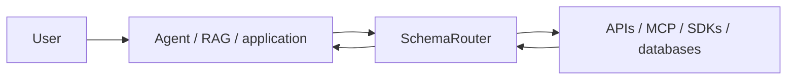

<p align="center">
  <picture>
    <source media="(prefers-color-scheme: dark)" srcset="https://raw.githubusercontent.com/JDeun/SchemaRouter/main/docs/assets/brand/schemarouter-lockup-dark.svg">
    
  </picture>
</p>

<p align="center"><strong>When tools speak different schemas, put a typed capability boundary in between.</strong></p>

<p align="center">
  <a href="README.md">English</a> ·
  <a href="README.ko.md">한국어</a> ·
  <a href="https://jdeun.github.io/SchemaRouter/">Docs</a> ·
  <a href="examples/README.md">Examples</a> ·
  <a href="CONTRIBUTING.md">Contributing</a> ·
  <a href="https://github.com/JDeun/SchemaRouter/releases/latest">Latest release</a>
</p>

<p align="center">
  <a href="https://github.com/JDeun/SchemaRouter/actions/workflows/ci.yml"></a>
  <a href="https://github.com/JDeun/SchemaRouter/actions/workflows/docs.yml"></a>
  <a href="https://github.com/JDeun/SchemaRouter/actions/workflows/codeql.yml"></a>
  <a href="https://github.com/JDeun/SchemaRouter/actions/workflows/security.yml"></a>
  <a href="https://pypi.org/project/schemarouter/"></a>
  <a href="https://pypi.org/project/schemarouter/"></a>
  <a href="https://github.com/JDeun/SchemaRouter/blob/main/LICENSE"></a>
</p>

> **Stable release: 0.17.0** · Beta / pre-1.0

SchemaRouter is a **typed capability routing and governed execution layer for AI agents across APIs, tools, and data systems**.

It sits between an orchestrator and external tools/data sources, compiles heterogeneous schemas into
one capability model, retrieves a bounded candidate set, and validates the selected call again at
execution time. It is not an agent framework, identity provider, database proxy, or LLM gateway.

```bash
pip install schemarouter
```

## Why SchemaRouter

A normal tool router mainly answers **which tool should I call?** SchemaRouter also keeps track of
**which endpoint, parameters, output fields, schema version, access path, policy, and execution
binding make that call valid**.

```text
user query
  -> required semantic fields
  -> bounded capability candidates
  -> endpoint + parameters + output fields
  -> policy / availability / schema validation
  -> trusted execution
  -> projected typed result
```

This is useful when a catalog mixes APIs, MCP servers, SDKs, databases, and framework tools whose
names overlap but whose schemas and execution constraints differ.

[Concepts →](docs/concepts/schema-router.md) ·
[Capability retrieval →](docs/concepts/capability-catalog.md) ·
[Execution boundary →](docs/concepts/execution.md)

## Quickstart

Provider-first onboarding lets an application start from the service it wants rather than knowing
every underlying protocol first.

```python
import asyncio

from schemarouter import PlanRequest, SchemaRouter


async def main():
    router = SchemaRouter()

    async with router:
        registration = await router.add_provider("apis-guru")
        tool = router.registry.get(registration.registered_tool_keys[0])

        plan = router.plan(
            PlanRequest(
                query="API directory metrics total number of APIs",
                preferred_tools=[tool.key],
                max_calls=1,
            )
        )

        result = (await router.execute(plan))[0]
        print(result.tool, result.endpoint, result.data["numAPIs"])


asyncio.run(main())
```

The flow is:

**provider identity → schema/adaptor resolution → typed capability registration → bounded selection → validated execution → typed result**

[Quickstart →](docs/getting-started/quickstart.md) ·
[Runnable examples →](examples/README.md)

## Where it fits



The surrounding application owns conversation, decomposition, memory, checkpoints, and final
generation. SchemaRouter owns the **registered capability and execution boundary**.

**Agent-neutral tool catalog:** the router first supplies a bounded, optionally
principal-authorized **index of available capabilities** (route ID, endpoint,
parameter/output-field contract). The agent/application interprets the task,
chooses whether and which tool to use, constructs its arguments and decides
whether to continue. SchemaRouter does **not** autonomously decide the next
agent step, call tools merely because they appeared in retrieval, or write a
final answer. Its optional `plan/execute` APIs are explicitly host-invoked
validation and execution boundaries, **not** an autonomous agent loop.
The research-only scoped index-to-schema experiment lives under `scripts/`;
it is not a new product-default model or a production `catalog_index` API.

Retrieval is side-effect free:

```python
candidates = router.retrieve("current Young's modulus for MAT-7", k=5)

for candidate in candidates.candidates:
    print(candidate.route_id, candidate.output_fields)
```

Use `retrieve_executable(...)` when the shortlist must also have a currently valid execution
binding.

For the original paper's **field-only routing** (which schema fields and typed
dependencies a caller would need, without fetching provider records), register
your source schemas and opt into `router.prepare_field_routing()` **without a
concept catalog** to begin owner review. Call
`session.inspect_visible_fields(principal=reader, limit=32)` first. After the
owner explicitly approves `NativeConceptCatalog`, call
`session = session.revise_catalog(catalog=reviewed_concepts)`; this activates
field routing **without rebuilding the registered-source index**. Alternatively
start with `router.prepare_field_routing(catalog=reviewed_concepts)` if your
application already has an approved catalog. Then call
`session.discover(query, principal=reader)` for field-complete alternatives or
`session.compile(query, principal=reader)` for typed, non-executing call shapes
and source/unit/license field metadata. Each compiled route also provides
`parameters_meta` (safe input names, required flags, locations, JSON type
labels), without exposing raw schema annotations or supplying argument values.
Each bounded page contains only currently authorized and visible scalar
field names, semantic IDs, type labels, units, safe source input parameter
shapes (`parameters_meta`: canonical name, required flag, location and basic
JSON types), and (when not scope-restricted) source/license labels. The input
projection uses the same live principal/data-scope rules as the guarded typed
plan; it excludes descriptions, wire aliases, raw JSON schemas, defaults and
argument values. At most 512 parameters per route and 2,048 per page share
the conservative 256 KiB review budget with output field metadata; oversized
routes fail explicitly. Follow
the fixed-size opaque `next_after_route` token by passing it as `after_route`
until it is `None`. That token is tied to the source snapshot and works even
when registered route names are unusually long or contain control characters.
This does not auto-author a `NativeConceptCatalog`, guess aliases or fetch
records: the host still reviews and explicitly declares concept meanings.
On a review-only session, `discover`, `compile`, `compile_understood`,
`acompile_query` and `catalog_revision_id` fail closed until catalog approval.
Recheck current authorization when using this inventory; a cursor is not
permission and different pages are not a policy-stable snapshot. The complete
operator-oriented Schema Explorer intentionally remains a separate interface
and is **not** a principal-safe substitute for this review API.
Keep the prepared session object **on the trusted host**: properties such as
`indexed_route_count` intentionally describe the full registered index, not
one principal's visibility. Expose only the principal-scoped page receipts to
consumer UIs. Pages have strict route (64), field (512 per route / 2,048 per
page), and conservative byte budgets; unusually wide or huge registered
schemas fail explicitly rather than silently omitting reviewable fields.
Those schemas require host-side splitting or a future field-granular paging
interface. Live, internally stateful availability callbacks are not an atomic
permission snapshot: owners must supply stable/versioned availability state
when they need transaction-like consistency and reauthorize later actions.
If your application already has structured `Understand(q)` hints, use
`session.compile_understood(PaperUnderstanding(...), principal=reader,
intent_registry=reviewed_intents)` to reuse the same prepared index and the
original source-proven direct/one-/two-hop graph compiler. The host must
review intent→concept contracts; model-proposed `parameter_hints` are never
used as call arguments. `compile_understood` does **not** call an LLM or any
provider. For natural-language paraphrases, the separate opt-in async method
`await session.acompile_query(query, principal=reader, model=host_callback,
intent_registry=reviewed_intents, model_visible_intent_ids=(...),
model_visible_concept_ids=(...), model_visible_tool_keys=(...))` invokes
**one host-owned model callback** with only explicitly disclosed, currently
field-proven intent/concept IDs and scoped tool keys. It strictly validates
the returned IDs, and delegates to that same source-proven direct/one-/two-hop
compiler. The caller is responsible for model privacy and deciding what to
disclose; the router never fetches provider rows, promotes model suggestions
to source authority, or binds model-proposed parameter values. An independent
model-understanding benchmark is still required.

After registered schemas change, the original prepared session becomes stale.
Call `new_session = session.refresh()` to create a new immutable field-routing
snapshot using the built-in in-memory/SQLite registry's verified change journal.
For a custom registry, pass `changed_tool_keys=(...)` to the same method; the
full native manifest is checked before accepting those hints. A missing,
expired or inconsistent delta fails closed (reprepare explicitly if needed).
Refreshing does not fetch provider records, invoke tool executors, or grant a
model permission to supply query arguments. The old session stays stale.
If **only the host-reviewed concept/field catalog changes** while registered
schemas stay at the same revision, call
`new_session = session.revise_catalog(catalog=updated_reviewed_concepts)`.
This revalidates and detaches the owner's bounded catalog while reusing the
same pinned posting/G5 graph, including host-approved roots; there is **no
schema rescan** or provider execution. Use `(new_session.snapshot_id,
new_session.catalog_revision_id)` to **partition host schema/semantic caches**:
the source-only `snapshot_id` intentionally stays unchanged across a catalog
revision. **Do not use this pair alone to cache or replay authorized
`discover()`/`compile()` results.** Those results depend on the live principal,
authorization policy, allowed scopes and availability, and require current
source and authorization rechecks at use time. The application must atomically
replace and retire its old handle
after approving new meanings: independently retained old sessions are **not
automatically revoked** by this API. Source changes still require `refresh()`;
a stale source refuses catalog-only revision.
The caller supplies an explicit authorization policy; a reviewed semantic
concept catalog is required **to route**, not to inspect source fields.
Undeclared or conflicting concept aliases raise `ValueError`
(no guessed mapping). Changes require a fresh session, either through verified
`refresh()`, catalog-only `revise_catalog()` or an explicit new
`prepare_field_routing` build; none grants execution permission. See the runnable
[provider-neutral field-routing example](examples/schema_only_field_routing.py).

## Connect tools and data

SchemaRouter supports several ingress families behind the same capability model.

| Family | Typical entry points |
| --- | --- |
| Provider identity | `await router.add_provider(...)` |
| Typed Python / ToolSpec | `add_callable(...)`, `add_tool(...)`, `add_bound_tool(...)` |
| API protocols | OpenAPI, MCP, OPTIMADE, GraphQL, OData, OpenRPC |
| Relational databases | SQLite, caller-owned SQLAlchemy Engine |
| Vector databases | Qdrant, Milvus, Pinecone, Weaviate, Chroma, PostgreSQL/pgvector |
| Graph / RDF | Neo4j, Neptune, ArangoDB, FalkorDB, SPARQL |
| Document / search / KV / time-series | MongoDB, Elasticsearch/OpenSearch, DynamoDB, Cosmos DB, Couchbase, ClickHouse, InfluxDB |
| Framework bridges | LangChain, LangGraph, LlamaIndex |

Credentials, connection pools, database clients, and transport state remain caller-owned. Vendor
query languages are not exposed as model authority.

[Choose an ingestion path →](docs/getting-started/ingestion-paths.md) ·
[Full ingestion matrix →](docs/guides/universal-ingestion.md) ·
[Provider-first registration →](docs/guides/provider-first-registration.md) ·
[Enterprise data onboarding →](docs/guides/enterprise-data-onboarding.md)

## Authorization and enterprise data

SchemaRouter consumes a verified `PrincipalContext` from the host application and can apply
deny-by-default RBAC/ABAC before retrieval and again at execution.

The same policy model can narrow:

- visible tools/endpoints;
- database tables and fields;
- trusted row/tenant filters;
- vector metadata filters;
- document/search fields;
- graph relationships and hop depth.

SchemaRouter does not authenticate users and does not replace database-native roles, grants, RLS,
ACLs, or network controls.

[Authorization →](docs/guides/authorization.md) ·
[Database onboarding →](docs/guides/database-onboarding.md)

## Execution boundary

A retrieved candidate or model choice never grants authority by itself. Before a result crosses the
runtime boundary, SchemaRouter can revalidate:

- tool/endpoint/schema fingerprints;
- arguments and JSON Schema contracts;
- principal policy and data scope;
- current execution binding and availability;
- raw output schema;
- final field projection.

Remote mutation/destructive operations fail closed unless explicitly authorized by local policy.

[Security model →](docs/security/threat-model.md) ·
[Trust and release evidence →](docs/project/trust-and-evidence.md)

## Stability

**Qualification status:** [19-item evidence checklist](QUALIFICATION.md) tracks engineering/DEV evidence, independent E2, blockers and the separate v0.18 release HOLD. Green CI does not imply task-level qualification.


SchemaRouter `0.17.0` is **Beta / pre-1.0**. Public APIs may still evolve,
but breaking changes are documented and release-gated.

Python 3.10–3.14 are release-blocking targets. Python 3.15 is a preview target.

Research benchmarks are kept separate from stable product guarantees. Experimental retrieval
profiles or ranking methods are not promoted solely because one benchmark improves.

[Versioning policy →](docs/versioning.md) ·
[Research status →](docs/research/routing-status.md) ·
[Changelog →](CHANGELOG.md)

## Documentation

| Topic | Guide |
| --- | --- |
| Installation and first use | [Getting started](docs/getting-started/installation.md) |
| Architecture and concepts | [What SchemaRouter is](docs/concepts/schema-router.md) |
| Provider/API ingestion | [Connect guides](docs/guides/provider-first-registration.md) |
| Enterprise databases and access scope | [Enterprise data onboarding](docs/guides/enterprise-data-onboarding.md) |
| Runtime policy and authorization | [Authorization](docs/guides/authorization.md) |
| Operational inspection | [Inspection](docs/guides/inspection.md) |
| Public API | [Reference](docs/reference/api.md) |
| Research evidence | [Research index](docs/research/experiment-index.md) |

Full documentation: **https://jdeun.github.io/SchemaRouter/**

## Scope

SchemaRouter deliberately does **not** own agent loops, final answer generation, identity
authentication, credential storage, or arbitrary database/query execution. Those remain outside the
capability boundary.

## License

MIT. See [LICENSE](LICENSE).
