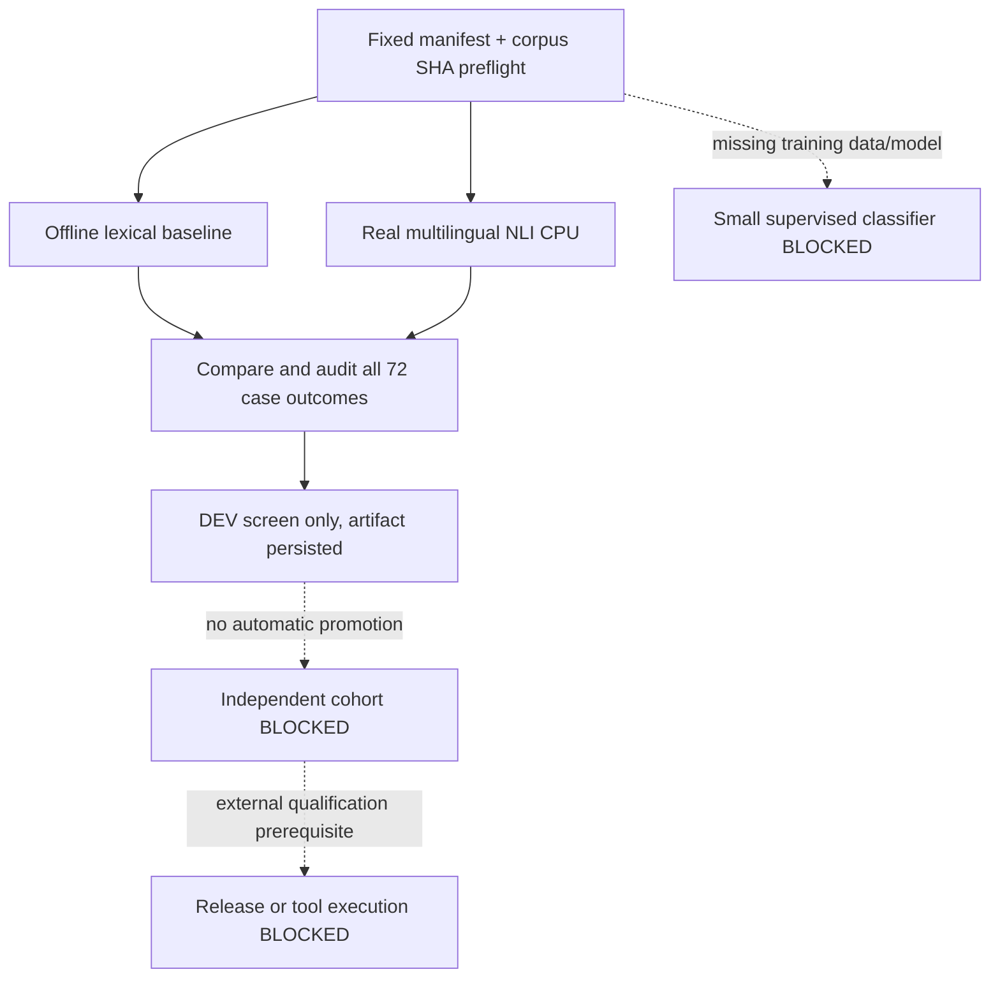

# Operation-Fit V1 DEV Conveyor (2026-10-15)

> **This is a new development-only conveyor, NOT v0.14 continuation or release
> qualification.** It takes the gate-and-provenance ideas from
> `scripts/research_014_conveyor.py` without importing its frozen artifacts,
> invoking its workflow or changing its historical outcomes.

## Automated DAG

The pipeline is `.github/workflows/research-operation-fit-conveyor-dev.yml`:
PR and manually dispatched runs only, **no timer/schedule, external API mutation,
hosted Jev key, v0.14 shared workflow, deploy, promotion or live tool execution**.

- Preflight: check exact manifest fields, known 72-case SHA256, 54 positives and
  18 negatives with 18/6 per EN/KO/JA, model revision, rejection requirements,
  and **unapproved** independent gate. Run offline negative/forgery tests.
- Baseline: reuse existing `evaluate_operation_intent_cpu_dev.py --model baseline`,
  produce a per-case JSON with source SHA.
- NLI: actual pinned [multilingual MiniLM NLI](https://huggingface.co/MoritzLaurer/multilingual-MiniLMv2-L6-mnli-xnli)
  model revision `0a71e92a985b6e1ad1828cf67ce9c459639c1dca`, MIT
  license. Nine fixed **English hypotheses** scored against the original
  request (EN/KO/JA). Records separate forced-choice and diagnostic 0.7
  entailment-gated arms. That score is an *unverified model output*, **not**
  an operation-fit permission or empirically calibrated reject probability.
- DEV gate: download precisely this run's baseline/NLI artifacts, recompute
  every row's case ID, supported vs unsupported labels, predictions, numerical
  metrics and source SHA. Store the screen outcome, **never fail an otherwise
  valid scientific run solely because model quality is poor**.
- Artifacts: preflight, baseline, NLI per-case rows, DEV gate; provenance
  available in this one GitHub Actions run. Manual model reruns can be
  enabled/disabled independently later, without silently changing scientific
  inputs.

## Development screening criteria (not release conditions)

| Field | Predeclared experimental screen |
|---|---:|
| Supported exact operation accuracy | >= 85% |
| Unsupported false acceptance | <= 5% |
| Supported false refusal | <= 10% |
| Supported wrong accepted operation | <= 3% |
| CPU p95 per-case inference | <= 250 ms |

These values are **design targets only**, not statistically justified operating
points. With just 18 negatives, one bad outcome is 5.56%, so zero false accepts
is required to pass <=5%, without supporting a 5% population claim.

## Why NLI and small classifier are different stages

NLI is a non-trained-in-repository zero-shot probe. It might reject ambiguities
better than cosine similarity, but results must be checked independently.
The separate small task-specific classifier is **blocked** until there is
an annotated training/development split, a disjoint test set, frozen model
artifact and a training-only tuning policy. Inventing a model checkpoint or
using the 72 observed examples as independent proof is prohibited.

The independent confirmation stage is explicitly blocked until the study
has externally authored and adjudicated labels, near-domain negatives,
actual provider tool descriptions (100/250/500 candidates), complete query
disjointness, model weight and data hashes, and a verified no-call end-to-end
harness. No frozen 0.14 heldout examples may be reused as development data.

## Promotion rule

**Regardless of whether the development screen passes:** outcome state stays
`DEV_COMPLETE_EXTERNAL_GATE_BLOCKED`, and
`may_promote_to_product=false`, `may_merge_release=false`,
`may_execute_tools=false`. Keep #1291/#1339/#1346 open and v0.18 #1356 HOLD.
The exact frozen v0.14 workflow remains **dry-run** as before.

## Known limitations

- Previously authored 72 examples have been observed repeatedly.
- User-premise / English-hypothesis NLI format may have translation asymmetry.
- Even an entailment prediction does not establish real tool-side capability.
- Model revision is pinned, but **the exact weight bytes are not independently
  attested** at runtime in the first iteration; inspect the downloaded
  checkpoint metadata before claiming full reproduction.
- Cross-check real CPU memory and latency, not just success of the Action.

## Extensible inventory and improvement discovery

The new `benchmarks/operation-fit-conveyor-v1-registry.json` contains exactly 13
named entries, with explicit status and provenance boundaries:

| Status | Count | Meaning |
| --- | ---: | --- |
| `active_stage` | 2 | Current offline lexical + CPU NLI pipeline |
| `completed_reference` | 4 | Prior MiniLM/E5, Laya, exemplar and cross-encoder DEV studies; references only, not automatically rerun |
| `incomparable_frozen_reference` | 2 | Earlier BGE / v0.14 research; distinct source cohorts, never pooled |
| `blocked` | 5 | Independent cases, real provider catalog, task-trained classifier, hosted Jev and real tool no-call |

The registry is an **inventory, not a task scheduler**. Any stage not in the
explicit allowlist remains blocked; source run/artifact IDs of historical
studies are retained for provenance, not counted as new model validation.
Changed corpus hashes, missing report documents, registered identities or
mutated status flags fail preflight.

The `development_gate` job also emits `opportunities.json`, joining the
**same current-run** baseline and NLI per-case predictions by immutable case
ID. It computes disagreement counts by language and operation, refusal
patterns, negative-case false acceptance, and individual failures. It
generates human-reviewable hypotheses (localized NLI hypotheses, a
task-trained contrastive selector and explicit negative veto), each marked
`PROPOSED_UNAPPROVED_NO_AUTO_EXECUTION`. These hypotheses **do not
demonstrate actual improvements**, choose hyperparameters, mutate the model
or add an automatic experiment. Prior independent and 0.14 heldout data
cannot be consumed by this stage.

A future approved and genuinely independent experiment must be separately
registered and reviewed with a pinned source revision, artifact integrity,
explicit compute budget, distinct calibration/confirmation splits, and no-call
execution safety evidence before eligibility can change. Until then,
`automatic_dispatch_enabled=false` and no release/tool authority can be
derived from any output.

## Class-collapse observability (2026-10-16; post-discovery)

The `opportunities.json` artifact now includes **descriptive**, deterministic
`class_collapse_diagnostics` for each current-run model arm. The system
reports accepted-vs-abstained totals; prediction counts for all nine
operations; the dominant predicted operation and its share **of all cases**
and **of accepted cases separately**; EN/KO/JA distributions; supported
per-class confusion; and unsupported predicted-operation counts.

Two explicitly **post-discovery heuristic** warnings are provided for
human review, not for calibrated decisions:

- If a model sends >= 50% of all examples to the same *wrong-for-some*
  operation, warn about majority-class misclassification concentration.
- If it accepts at least five cases and >= 65% of its accepted predictions
  concentrate on a single wrong-for-some operation, warn about accepted
  class concentration. The accepted-only denominator avoids obscuring
  collapse by large numbers of abstentions.

The original 2026-10-15 NLI run had a `directions` concentration. The
heuristics were added **after** seeing that phenomenon; they must never
be presented as prospective evidence of quality or serve as a model
promotion/selection threshold. The CLI continues to require fully audited
72-row same-run evidence, preserves previously registered experiment
states, and never triggers new training or model runs on its own.

## Autonomy and repository write boundaries

This pipeline runs **only on PR changes or manual workflow dispatch**.
Its 13-entry registry is an inventory, **not an autonomous scheduler**.
It does **not** use GitHub credentials to create issues, edit product code,
spawn new research runs, open PRs, merge PRs, close issues or publish releases.
No calendar schedule/cron, conditional research planner or self-updating
training step has been enabled.

Any proposed autonomous system should keep a separate human-reviewed
control plane with explicit scope/allowlist, action budgets, isolated branches,
protected CI, trustworthy evaluators and rollback. In particular, a
model-generated hypothesis cannot authorize its own merge or certify the
same model's performance. The v0.18 HOLD and independent #1346 external
release gate remain binding.
