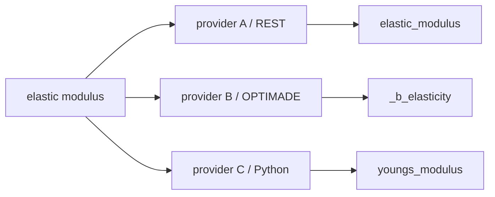
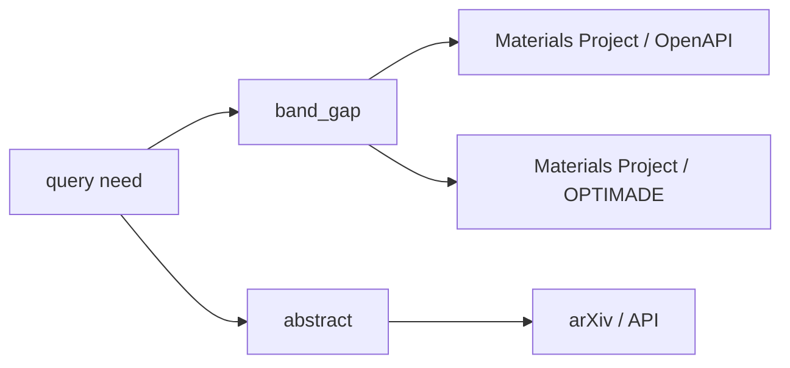
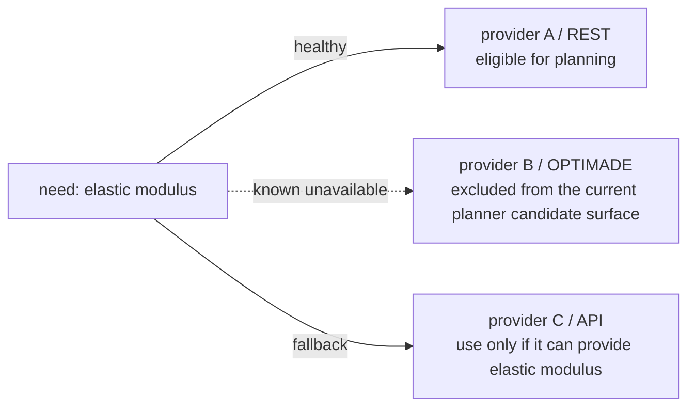

# Field-first execution

SchemaRouter is designed around a **field-first, route-second** principle.

The goal is not merely to choose a tool. The goal is to identify the smallest declared data surface
that can answer the user's question, then choose a trusted access path that can provide that surface.

```text
user query
  -> semantic data need
  -> required logical fields
  -> providers/access paths that can supply those fields
  -> availability + policy + evidence
  -> server-side field selection when supported
  -> raw schema validation
  -> final local projection
  -> minimal ToolResult context
```

The prepared `SchemaFieldRoutingSession` path accepts host-reviewed direct response requirements
for scalar, nullable, array, object and map fields, including declared constraints. It also accepts
bounded, acyclic references through object-key JSON pointers inside the same field descriptor.
External references, anchors, endpoint-root context recovery, unknown schemas and unconstrained
wrappers are excluded. Schema syntax, validation-work limits and conservative assertion compatibility
are checked before a source field can qualify. Each complete required field group must survive current
authorization, visibility, availability and source checks before K5 disclosure or typed planning.

G5 dependency producers still require scalar, unitless identifiers; trusted host inputs retain their
existing scalar limits. A source container overlapping a declared hidden descendant is excluded even
when their result paths differ. Restricted views keep their schema stripping: removed nested contract
details are never recovered from the raw registry to manufacture a field proof.

Requirements use the canonical output contract after an explicitly declared unit normalization.
Raw source assertions are validated before conversion. Canonical bounds and finite values are
transformed; predicates that cannot be proved after conversion are omitted only from the canonical
description, so a stricter requirement remains unproved. Identity normalization preserves the
original numeric value and type. This prepared path remains opt-in and does not change default routing.

## Prepared schema-only plans

`router.prepare_field_routing(catalog=...)` prepares a source-pinned index with a host-reviewed
concept catalog. `session.compile_understood(...)` checks a `PaperUnderstanding` against that catalog
and the host's `PaperIntentRegistry`. In `session.acompile_query(...)`, omitting
`model_visible_concept_ids` selects the schema-independent model protocol: the application's model
receives the query, fixed intent names and response format/rules, without concept aliases, field
names, tool catalog or route IDs. Passing an explicit tuple retains the earlier offered-ID protocol,
which discloses the approved concept IDs/aliases and tool names. These APIs are opt-in. The default `KeywordAnalyzer` in
`router.plan(...)` remains lexical: it does not provide general multilingual understanding, temporal
reasoning or extraction of argument values from query text.

Each concept's complete required field group is proved independently at an authorized endpoint
under its own source type and license. In `NativeDeclaredConcept`, `source_type=None` and
`license=None` impose no source-type or license constraint; they do not remove actual source metadata.
Independent concepts can therefore use different tools and licenses. Concepts sharing a semantic ID
but requiring incompatible schemas, units or qualifiers retain separate proofs rather than being
merged by ID alone. Proven routes are combined, and repeated routes retain the union of selected
fields in source declaration order. Identifiers and owner-required intent groups preserve recall;
the result does not promise an unconditional minimum field count. The combined route set remains bounded by
K5: a union exceeding five routes returns `budget_unsatisfied` without calls.
Generic intents may declare `required_concept_ids=()`; they add no arbitrary representative field.

`session.inspect_visible_fields(principal=...)` provides the currently scoped field JSON schemas,
aliases, qualifiers and source/result paths for owner review. These detached declarations let a host review
its concept/alias relationships without reading private registry state. Restricted views may omit
metadata and replace paths with public field names; review never reconstructs hidden originals or
approves a concept catalog automatically.

The schema-independent response uses `PaperQueryUnderstanding`. For example, this illustrates its
shape; it supplies no source or execution authority:

```json
{
  "intent_id": "information.lookup",
  "needs": [{"concept": "temperature", "unit": "Cel", "source_type": "weather",
             "qualifiers": {"time": "current"}}],
  "needs_truncated": false,
  "excluded_concepts": ["forecast temperature"],
  "named_tools": ["weather"],
  "parameter_hints": {"city": "Seoul"},
  "source_type": null
}
```

After understanding, each whole short English concept is matched exactly, using existing
normalization, to a host-declared concept ID or complete alias. The host's contracts must also
support its explicit unit, source type and qualifiers; unknown role/path/time conditions remain
unproved. Units, source types and qualifier values must match declarations exactly, with one declared
field supporting all conditions on a need together. This resolution infers no unit conversion or
role/path/time mapping. This is bounded declared-alias resolution, not general semantic understanding.
Owners may share a complete alias between concepts only when their declared source types, units or
qualifiers distinguish them. Explicit query conditions must leave exactly one matching concept;
missing or insufficient conditions remain ambiguous, regardless of source access or availability.
A per-need source condition narrows a concept only where its owner left `source_type=None`; it
cannot overwrite a declared owner source constraint, including one required by intent recall.

`plan.coverage` records `required`, `covered`, `uncovered` and `complete`. In this model protocol,
requirements retain the raw concept labels and their unit/source/qualifier conditions. Exclusions
and explicitly user-named sources also remain requirements: a named source must be currently visible
and contribute an actual selected field from the current scoped view. That field must be
typed-compatible with the requested owner contract and satisfy the same need's unit/source/qualifier conditions and
owner license constraint. A shared semantic ID or an unrelated intent-recalled field is insufficient.
Negated fields cannot be restored by an intent's required group.
A missing need can leave proven partial `calls` with `status="no_proven_hit"` and `complete=False`.
`intent_id=null` returns `no_proven_hit` with no calls and incomplete coverage. Structured
`compile_understood` coverage instead uses field semantic IDs with concept/source/license qualifiers;
its `unresolved_concepts` remain uncovered with the raw proposal in `query_concept=...`.

Schema-independent query input is bounded to 4,096 characters and 16,384 UTF-8 bytes. A response
contains at most eight needs and 4,096 bytes. If more needs remain, the model must set
`needs_truncated=true`; the receipt returns `budget_unsatisfied`, no calls and incomplete coverage.
These checks cannot detect every requirement omitted by the model and do not establish commercial
query-to-field accuracy.

Both model-query protocols include source-proven field requirements and scalar input conditions in
coverage. `parameter_hints` remain untrusted proposals: each key must identify a unique current scoped
`ParameterSpec` by its name, explicit alias or semantic ID. Hints are never broadcast across inputs,
automatically bound as arguments or treated as evidence of an implicit output postfilter relation.
Only separately supplied `host_source_arguments` for approved roots can bind values, subject to the
existing source and value validation.

An unbound proposal that fits the fully exposed scalar input contract can prove the input mapping
with `proof=pending_host_input`. Coverage may then be complete while an otherwise ready plan waits
with `requires_arguments`. This also applies to a source-optional input needed by the question:
`ParameterSpec.required` and `call.missing_required_arguments` retain the original source requirements.
A matching, already validated host argument proves the condition using exact JSON scalar agreement.
Invalid proposals, conflicting host values, ambiguous inputs and unproved source relations remain
uncovered. Removed private schema constraints are not recovered to test proposed values; their fit
remains unproved. Uncovered conditions change an otherwise ready plan to `no_proven_hit`, while
existing `requires_arguments` or `requires_observation` diagnoses remain intact.

Each call's `fields_meta` exposes `PaperPlanFieldMeta.source_path`, `result_path` and `json_schema`
from the current scoped schema view, including its canonical unit/value contract. Policy may flatten
paths or redact metadata. The model-backed query receipt also carries detached, validated
`understanding_hints`; these remain untrusted suggestions, not verified query meaning or input
authority. All these receipts retain `executable_authority=False`, including `status="ready"`.

## Why field-first matters

If a user asks for one material property such as elastic modulus, fetching a complete material
record can create avoidable cost:

- more upstream response bytes and latency;
- more JSON parsing and validation work;
- more irrelevant values in downstream LLM context;
- more prompt tokens;
- a higher chance that unrelated properties distract answer generation.

SchemaRouter therefore treats response fields as part of the execution plan rather than an
afterthought.

## Logical fields before provider selection

Different providers and access modes can expose the same concept under different names:



Local `FieldSpec` contracts declare known semantic equivalence. Prefer one canonical local
`FieldSpec.name` for the concept. Keep provider-specific request selector names in
`ServerProjectionSpec.field_map`, provider response locations in `FieldSpec.path`, and use
`FieldSpec.result_path` when the final projected result should be written to a different canonical
location. `aliases` help the planner recognize user phrasing and legacy/provider terminology.

For example, all three access paths can expose the local field `elastic_modulus` while mapping it
to `elastic_modulus`, `_b_elasticity`, or `youngs_modulus` on the wire. A provider-specific
source path can still be projected into `result_path=["elastic_modulus"]`, so the planner and final
`ToolResult` stay provider-neutral.

The model does not get to invent field mappings.

## Unit metadata is optional by field semantics

`FieldSpec.unit` is a general optional contract, not an arXiv/Web special case.

A field should carry a unit only when the value is a physical or otherwise explicitly unit-bearing
quantity. Unitless fields can come from any provider or access mode:

```text
paper abstract / title / snippet   -> string, unit=None
material identifier / DOI         -> string, unit=None
phase / category / label          -> string, unit=None
flags                             -> boolean, unit=None
structured metadata              -> object/array, unit=None
dimensionless score or ratio      -> number, unit=None
physical quantity                 -> number/array, unit="..." when declared
```

OpenAPI, MCP, OPTIMADE, Python, documentation-derived adapters, or any approved plugin
can expose unitless fields. The source type does not decide whether a unit exists; the field
contract does.

If a caller explicitly sets global `EvidenceRequirements(units=True)`, every selected answer
field must satisfy that evidence requirement. That is strict, and different from
saying unitless fields are invalid.

For mixed requests, evidence can be scoped to a semantic field instead:

```python
PlanRequest(
    query="band gap and paper abstract",
    max_calls=2,
    field_evidence={
        "band_gap": EvidenceRequirements(units=True),
    },
)
```

The materials route must then provide unit metadata for `band_gap`, while a unitless arXiv
`abstract` remains eligible. Field-specific evidence is matched through trusted
`FieldSpec.semantic_id` (falling back to the field name when no semantic ID is declared), so
provider-specific field names can still satisfy the same semantic requirement without model-authored
mapping.

At execution time, evidence is checked again rather than trusted from the planner. A compiled call
therefore separates the **required** evidence contract from the **available** route evidence. This
keeps a forged or manually edited `ToolCall` from turning a declared requirement into execution
authority merely by setting an evidence flag.

## Heterogeneous multi-source field requirements

One user question can require fields that no single endpoint provides. SchemaRouter can compile a
bounded multi-call plan when the caller explicitly allows more than one call with `max_calls`.

For example:



With `max_calls=2`, multi-call planning prefers **complementary semantic field coverage** over
spending both call slots on equivalent access paths for the same already-covered field. Equivalent
routes collapse through `semantic_id`; an exact qualifier such as `temperature=300 K` remains a
separate requirement only when that qualifier is visibly requested.

```python
plan = router.plan(
    PlanRequest(
        query="band gap and paper abstract",
        max_calls=2,
    )
)
```

The hard bound remains `max_calls`; SchemaRouter never increases it automatically and may use fewer
calls when one route already covers the remaining semantic field requirements. The default is `1`,
so multi-source fan-out is an explicit cost/authority choice by the application.

Each call still receives its own field projection, schema fingerprint, provider/access identity,
health/binding checks, policy checks, and fallback chain. If all calls are explicitly read-only,
the executor can use the bounded `parallel_read_only` execution surface; otherwise normal
execution remains sequential and policy-gated.

## Two layers of projection

SchemaRouter minimizes data at two different boundaries.

### 1. Server-side projection

When an endpoint has an explicit trusted `ServerProjectionSpec`, planned fields are pushed into
the upstream request:

```python
EndpointSpec(
    name="search",
    # ...
    server_projection=ServerProjectionSpec(
        parameter="fields",
        field_map={
            "elastic_modulus": "elasticity.bulk_modulus",
        },
    ),
)
```

A call selecting only:

```text
material_id
elastic_modulus
```

can therefore become:

```text
GET /materials?fields=material_id,elasticity.bulk_modulus
```

SchemaRouter never guesses that a generic OpenAPI parameter means field projection. The contract
must be declared locally or by a trusted adapter. OPTIMADE's `response_fields` is a built-in
example.

For explicit provider source paths such as `elasticity.bulk_modulus`, projected raw-schema
validation can narrow nested **object-only** paths recursively. A root array whose items are objects
is also supported. Paths that require traversing an array, unresolved `$ref`, unions, or another
shape that cannot be narrowed conservatively keep the full declared schema and therefore fail
closed rather than weakening validation.

### 2. Final local projection

Even when an upstream service ignores or cannot perform server-side projection, SchemaRouter
validates the raw response and then keeps only the planned logical fields before producing the
`ToolResult`.

So the downstream answer-generation context stays narrow even when the provider returns a broader
payload.

## Availability changes the route, not the data need

The requested field surface remains stable while access paths can change:



Fallback does not broaden the requested fields merely because the preferred route failed.
A newly observed outage is handled by the precompiled fallback chain; once that route enters the
bounded cooldown, later plans exclude it until the cooldown expires or a trusted health signal
reopens it.

See [Provider-aware fallback](../guides/provider-fallback.md).

## Passive and active availability

Transport failures such as timeouts, connection failures, HTTP 429, or transient 5xx responses can
place an access path into a bounded cooldown. Cooldown always expires, so a path is never permanently
blacklisted by one failure.

For faster recovery, applications can register trusted read-only health probes. A background health
monitor can reopen a path immediately after a probe succeeds.

The monitor never invents a probe and never turns arbitrary data calls into health checks.

## Recall-first safety boundary

Field minimization is aggressive only when the query-to-field match is clear.

If SchemaRouter cannot confidently identify the answer field, the default planner preserves declared
fields rather than pretending to know which one is sufficient. This protects answer recall.

So the rule is:

```text
clear semantic match -> minimize
ambiguous semantic need -> preserve recall
```

Applications that need stronger domain-specific minimization should improve local aliases/schemas or
use a bounded analyzer rather than weakening validation.


## Typed scientific fields and units

Field selection is not only about names. Scientific fallbacks must preserve the value contract.

`FieldSpec.json_schema` carries the declared value type/shape and `FieldSpec.unit` carries the
provider source unit. When providers use different units for the same semantic field, applications
can add an explicit `UnitNormalizationSpec`:

```python
FieldSpec(
    name="elastic_modulus",
    semantic_id="elastic_modulus",
    json_schema={"type": "number"},
    unit="GPa",
    unit_normalization=UnitNormalizationSpec(
        dimension="pressure",
        canonical_unit="Pa",
        scale=1e9,
    ),
)
```

SchemaRouter does **not** infer conversion factors from unit strings. Unit symbols are
case-/punctuation-sensitive and the conversion contract is trusted local configuration.

Fallback compatibility is conservative:

```text
same semantic field
  AND explicit compatible JSON value type
      (required for unit-bearing cross-provider fallback)
  AND (
        same explicit source unit
        OR same declared dimension + same canonical unit
      )
```

A unit label by itself is not enough to establish a scientific value contract. If a unit-bearing
field participates in automatic provider fallback, both sides must expose an explicit datatype
shape through `FieldSpec.json_schema` or the declared endpoint output schema. Unknown datatype +
known unit is treated as insufficient evidence for automatic fallback.

When both a field-level schema and a raw endpoint output schema describe the same value, their type
shapes must be compatible. The whole raw response is validated first, then selected values are also
validated against any stronger `FieldSpec.json_schema` contract before unit normalization.

Numeric type compatibility is directional: an integer-producing fallback can satisfy a numeric
requirement, but an arbitrary number-producing fallback cannot satisfy an integer-only requirement.
Numeric arrays also compare their item types.

Execution order remains fail-closed:

```text
provider raw value
  -> raw JSON Schema validation
  -> field projection / canonical result path
  -> explicit unit normalization
  -> ToolResult
```

This means a provider returning `"130"` for a numeric GPa field fails before conversion.

`ToolResult.field_contracts` exposes metadata for selected fields **actually present** in the locally projected response. A requested but omitted field has no contract:

```python
result.field_contracts["elastic_modulus"]
# ResultFieldContract(
#     semantic_id="elastic_modulus",
#     json_schema={"type": "number"},
#     source_unit="GPa",
#     unit="Pa",
#     dimension="pressure",
#     has_observed_value=True,
# )
```

So answer-generation code can consume a compact canonical value plus the unit/type contract without
pulling unrelated provider metadata into context.

`ResultFieldContract.has_observed_value` explicitly separates **value presence** from schema/unit
metadata: `True` means at least one non-null projected leaf is present; `False` means a
selected field was explicitly present but has no non-null leaf (for example, `null`,
a null-only object/array, or an explicit empty array `[]`). Its declared unit and schema
remain available; an entirely **missing field** has no field contract. `None` means an
alternate producer has not established presence. This flag does **not** verify
scientific correctness, authorize the source, or validate the final answer. `projected_fields`
continues to describe requested projection intent, not observed facts.

Affine conversions are supported explicitly:

```text
canonical_value = source_value * scale + offset
```

This covers SI-prefix scaling and offset units when the application declares the exact conversion.
For example, `degC -> K` can use `scale=1.0, offset=273.15`. A source unit that is already equal
to the canonical unit must use the identity transform; contradictory same-unit conversion contracts
are rejected or excluded from fallback.

The planner compares the **post-normalization result datatype**, not just the provider raw datatype.
For example, an integer source value converted by an affine unit contract is treated as a canonical
JSON `number`, so a provider that already returns the canonical quantity as `number` can be a
valid fallback.

Unit symbols remain exact and case-/punctuation-sensitive. Surrounding whitespace is rejected.
Nonlinear/logarithmic conversions are not inferred or synthesized. Non-finite/overflowed normalized
values fail closed.


## Scientific field qualifiers

A semantic field name, datatype, and unit are not always sufficient to prove that two scientific
values are interchangeable. The value may depend on a fixed measurement/material context such as:

- temperature;
- pressure;
- phase;
- crystal orientation;
- measurement method;
- sample state.

`FieldSpec.qualifiers` is an optional trusted exact-string map for this context:

```python
FieldSpec(
    name="elastic_modulus",
    semantic_id="elastic_modulus",
    json_schema={"type": "number"},
    unit="GPa",
    qualifiers={
        "temperature": "300 K",
        "phase": "alpha",
        "orientation": "[100]",
    },
)
```

Qualifiers are optional. Text/document/search fields and scientific fields with no fixed contextual
constraint normally keep `qualifiers={}`.

Automatic provider fallback requires exact qualifier equality after semantic/type/unit checks. A
300 K field is therefore not silently substituted with a 500 K field, and a qualified field is not
silently substituted with an unqualified field.

Qualifier values are opaque and case-sensitive. SchemaRouter does not infer that
`300 K` equals `26.85 degC`, normalize phase names, parse crystallographic notation, or derive a
measurement condition from natural language. If multiple provider representations are known to mean
the same condition, trusted adapter/application code should canonicalize them before registration.

Selected qualifiers are preserved in `ToolResult.field_contracts`, so downstream answer generation
can consume the minimal value together with the context that gives the value its meaning.


### Qualifier-aware routing remains lexical and bounded

Trusted qualifiers can also break ties between otherwise equivalent schema candidates when the
qualifier value is visibly present in the user query. For example, between two
`elastic_modulus` endpoints qualified as `300 K` and `500 K`, the query
`elastic modulus at 500 K` receives a deterministic score boost only for the `500 K` field.

This is exact lexical routing, not scientific inference. SchemaRouter does not convert temperatures,
expand synonyms, or infer unstated experimental conditions. ASCII and numeric qualifier values are matched on token boundaries, so `300 K` does not match
`1300 K`. Very short ASCII qualifier values are not matched by value alone. Bounded field-selection backends also
receive the trusted qualifier tags in their option descriptions, while execution metadata remains
outside the decision surface.
