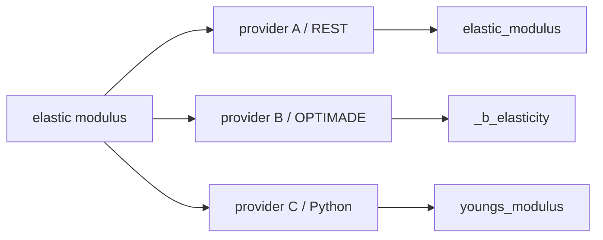
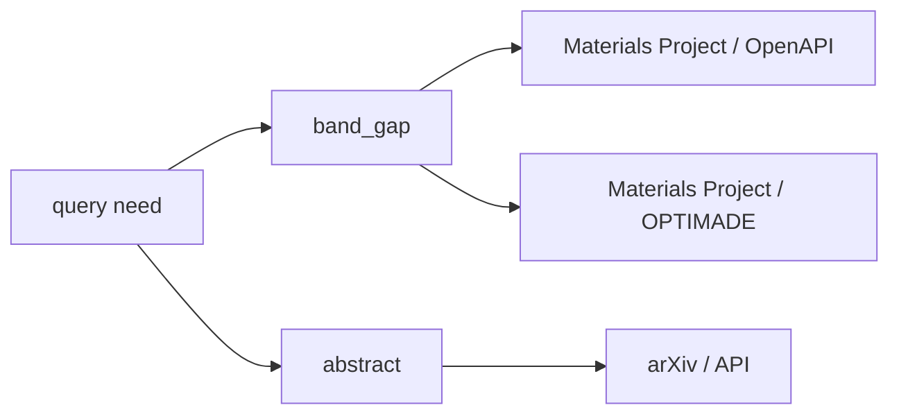
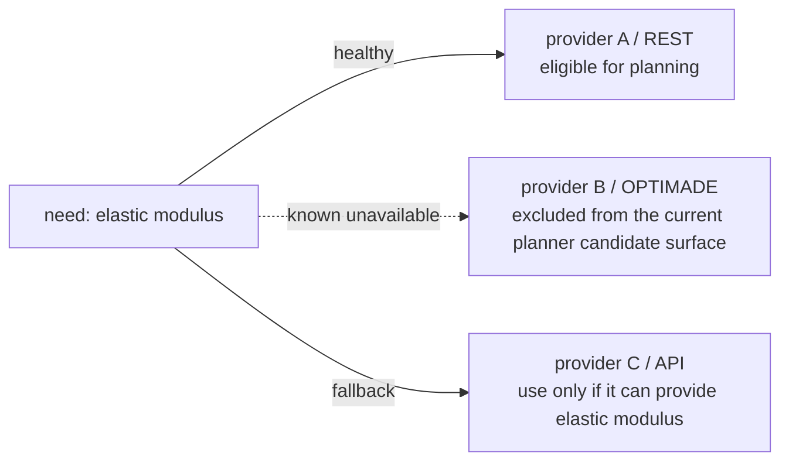

# Field-first execution

SchemaRouter는 **field-first, route-second** 원칙으로 설계됩니다. 목표는 tool 하나를 고르는 것이 아니라 사용자 질문에 답할 수 있는 가장 작은 declared data surface를 찾고 그 surface를 제공할 trusted access path를 선택하는 것입니다.

```text
user query
  -> semantic data need
  -> required logical fields
  -> providers/access paths that can supply those fields
  -> availability + policy + evidence
  -> server-side field selection when supported
  -> raw schema validation
  -> final local projection
  -> minimal ToolResult context
```

준비된 `SchemaFieldRoutingSession` 경로는 호스트가 검토한 직접 응답 요건으로 스칼라·nullable·배열·객체·map 필드와 선언된 제약을 지원합니다. 같은 필드 descriptor 내부에서 객체 키를 가리키는 JSON pointer 참조도 작업량이 제한되고 순환하지 않으면 지원합니다. 외부 참조, anchor, endpoint-root 문맥 복구, 알 수 없는 schema와 무제약 wrapper는 제외합니다. 원본 필드를 적합 후보로 판단하기 전에 스키마 문법, 검증 작업량 한도와 보수적인 제약 호환성을 검사합니다. 필수 필드 집합 전체가 현재 권한·노출 범위·가용성·원본 검사를 통과해야 K5 후보 공개와 타입 기반 계획 수립으로 이어집니다.

G5 dependency producer에는 계속 단위 없는 스칼라 identifier가 필요하며, 신뢰된 호스트 입력의 기존 스칼라 한도도 유지합니다. 원본 container가 선언된 숨김 하위 필드와 겹치면 결과 경로가 달라도 제외합니다. 제한된 view의 schema stripping도 유지합니다. 필드 요건을 입증하려고 raw registry에서 제거된 중첩 계약 정보를 복구하지 않습니다.

필드 요건은 명시적인 단위 정규화를 거친 최종 출력 계약과 비교합니다. 원본 값의 제약은 변환 전에 검증하고, 최종 값의 경계와 유한한 값 목록은 변환합니다. 변환 후 성립을 입증할 수 없는 술어는 최종 값 설명에서만 생략하므로 더 엄격한 요건은 미입증 상태로 남습니다. 항등 변환은 원래 숫자 값과 타입을 보존합니다. 준비된 경로는 명시적으로 선택해야 하며 기본 라우팅을 바꾸지 않습니다.

## 준비된 schema-only plan

`router.prepare_field_routing(catalog=...)`는 호스트가 검토한 concept catalog와 원본에 고정된 index를 준비합니다. `session.compile_understood(...)`는 `PaperUnderstanding`을 그 catalog 및 호스트의 `PaperIntentRegistry`와 대조합니다. `session.acompile_query(...)`에서 `model_visible_concept_ids`를 생략하면 schema-independent 모델 프로토콜을 사용합니다. 애플리케이션의 모델에는 질문, 고정된 intent 이름과 응답 형식·규칙만 전달하며 concept alias, 필드 이름, tool catalog, route ID는 보내지 않습니다. 명시적인 tuple을 전달하면 승인된 concept ID/alias와 tool 이름을 공개하는 기존 offered-ID 프로토콜을 유지합니다. 이 API들은 명시적으로 선택해야 합니다. `router.plan(...)`의 기본 `KeywordAnalyzer`는 어휘 기반이며, 일반적인 다국어 이해·시간 조건 추론·질문에서 인자 값을 추출하는 기능을 제공하지 않습니다.

각 concept의 필수 필드 집합 전체를 그 concept의 source type과 license에 따라 권한이 있는 endpoint에서 독립적으로 입증합니다. `NativeDeclaredConcept`의 `source_type=None`과 `license=None`은 source type이나 license를 제한하지 않는다는 뜻이며, 실제 원본 metadata를 제거하지 않습니다. 따라서 독립적인 concept들은 서로 다른 tool과 license를 사용할 수 있습니다. Semantic ID가 같더라도 schema·단위·qualifier 요건이 호환되지 않으면 ID만으로 합치지 않고 독립적인 입증을 유지합니다. 입증된 route들을 합치고, 반복되는 route는 선택 필드의 합집합을 원본 선언 순서로 보존합니다. Identifier와 호스트가 요구한 intent group은 recall을 보존하며, 결과가 항상 최소 필드 수라고 보장하지는 않습니다. 전체 route 집합은 K5 한도를 따르므로 합집합이 다섯 route를 넘으면 call 없이 `budget_unsatisfied`를 반환합니다.
일반 intent는 `required_concept_ids=()`를 선언할 수 있으며, 임의의 대표 필드를 추가하지 않습니다.

`session.inspect_visible_fields(principal=...)`는 owner 검토를 위해 현재 노출 범위의 필드 JSON schema, alias, qualifier와 원본·결과 경로를 제공합니다. 호스트는 원본과 분리된 이 선언으로 비공개 registry 상태를 읽지 않고 concept·alias 관계를 검토할 수 있습니다. 제한된 view는 metadata를 생략하거나 경로를 공개 필드 이름으로 바꿀 수 있습니다. 검토 API는 숨겨진 원본 정보를 복구하거나 concept catalog를 자동 승인하지 않습니다.

Schema-independent 응답은 `PaperQueryUnderstanding`을 사용합니다. 다음 예시는 그 형식만 보여 주며, source나 execution 권한을 부여하지 않습니다.

```json
{
  "intent_id": "information.lookup",
  "needs": [{"concept": "temperature", "unit": "Cel", "source_type": "weather",
             "qualifiers": {"time": "current"}}],
  "needs_truncated": false,
  "excluded_concepts": ["forecast temperature"],
  "named_tools": ["weather"],
  "parameter_hints": {"city": "Seoul"},
  "source_type": null
}
```

모델 요청은 모든 응답 채널과 각 need의 조건 항목을 명시적으로 요구하며, 해당하지 않으면 빈 collection이나 `null`을 사용하게 합니다. 공개 DTO의 기본값은 선택 항목을 생략한 기존 응답도 계속 디코딩합니다. 추출 규칙은 지원되지 않거나 `intent_id=null`인 경우에도 요청한 모든 긍정적인 데이터 항목·행동·목표와 명시적인 조건·스칼라 값을 보존하도록 요구합니다. 적용 가능한 가장 좁은 listed intent와 추가 need를 요청하며, 호스트가 요구한 intent group은 계속 엄격하게 유지합니다. 부정된 concept은 긍정적인 need나 qualifier가 아닌 `excluded_concepts`에만 둡니다. 명시적인 literal 경로는 원래 표기대로 `qualifiers.source_path` 또는 `qualifiers.result_path`에 둡니다. 스칼라 hint는 명시된 parameter 라벨을 유지하고, 라벨이 없으면 짧은 영어 의미 역할 이름을 사용합니다. `source_type`은 주제가 아닌 명시적인 출처·원본 종류 제한을 뜻합니다. 이러한 추출 지침은 모델이 요청한 모든 의미를 보존한다고 보장하거나 과거에 기록된 정확도를 높였다고 입증하지 않습니다.

질문을 이해한 뒤에는 짧은 영어 concept 전체를 기존 정규화 규칙에 따라 호스트가 선언한 concept ID 또는 alias 전체와 정확히 대조합니다. Owner가 선언한 의미 조건으로 후보를 좁히며, alias 일치만으로 요청한 조건을 입증하지는 않습니다. 현재 scoped view에서 선택된 필드가 owner 계약과 동일 need의 단위·source·출력 조건을 지원해야 하며, 입력과 구조적 경로 조건은 아래 규칙으로 입증합니다. 알 수 없는 조건은 미입증 상태로 남고, 이 단계에서 단위 변환이나 선언되지 않은 role/time 매핑을 추정하지 않습니다. 이는 범위가 제한된 선언 alias 해석이며 일반적인 의미 이해를 보장하지 않습니다.

Owner가 선언한 source type, 단위 또는 qualifier로 concept을 구별할 수 있을 때만 같은 alias 전체를 공유할 수 있습니다. 질문의 명시적 조건을 적용한 뒤 정확히 하나의 concept만 남아야 합니다. 조건이 없거나 부족하면 source 접근 권한이나 가용성과 관계없이 모호한 상태로 남습니다. Need별 source 조건은 owner가 `source_type=None`으로 둔 경우에만 concept의 source 범위를 좁힙니다. Intent recall에 필요한 concept을 포함해 owner가 선언한 source 제약을 덮어쓸 수 없습니다. 전역 및 need별 source 제한이 모두 성립해야 하며, 충돌은 uncovered로 남습니다.

`plan.coverage`는 `required`, `covered`, `uncovered`, `complete`를 기록합니다. 이 모델 프로토콜에서는 요구에 raw concept 라벨과 unit/source/qualifier 조건을 보존합니다. 제외 조건과 사용자가 명시한 source도 요구로 남으며, 명시된 source는 현재 노출 범위에 있고 실제 선택된 필드를 기여해야 합니다. 그 필드는 요청한 owner 계약과 타입이 호환되어야 하며, 동일 need의 unit/source/qualifier 조건과 owner의 license 제약도 만족해야 합니다. Semantic ID가 같거나 무관한 intent recall 필드가 있다는 것만으로는 충분하지 않습니다. Intent의 필수 group이 부정된 필드를 복원할 수는 없습니다. 요구 일부를 충족하지 못하면 입증된 부분 `calls`를 남기되 `status="no_proven_hit"`, `complete=False`를 반환할 수 있습니다. `intent_id=null`이면 call 없이 불완전한 coverage와 `no_proven_hit`를 반환합니다. 구조화된 `compile_understood`의 coverage는 필드 semantic ID에 concept/source/license qualifier를 붙이며, `unresolved_concepts`는 원문 제안을 `query_concept=...`에 담아 미충족 목록에 남깁니다.

Schema-independent 질문 입력 한도는 4,096자와 UTF-8 16,384바이트입니다. 응답은 최대 8개 need와 4,096바이트로 제한합니다. 담지 못한 요구가 더 있으면 모델은 `needs_truncated=true`를 설정해야 하며, receipt는 call 없이 `budget_unsatisfied`와 불완전한 coverage를 반환합니다. 이 검사는 모델이 누락한 모든 요구를 찾아낼 수 없으며 상용 query-to-field 정확도를 입증하지 않습니다.

두 모델-query 프로토콜 모두 원본으로 입증된 필드 요건과 스칼라 입력 조건을 coverage에 포함합니다. `parameter_hints`는 신뢰하지 않는 제안입니다. 각 키는 현재 scoped `ParameterSpec`의 이름·명시적 alias·semantic ID를 통해 유일한 입력에 대응해야 합니다. Hint를 여러 입력에 일괄 적용하거나 인자로 자동 연결하지 않으며, 암묵적인 출력 postfilter 관계의 근거로 삼지 않습니다. 승인된 root에 별도로 제공한 `host_source_arguments`만 기존 원본·값 검증을 거쳐 인자로 연결할 수 있습니다.

Schema-independent 프로토콜에서는 각 need의 `qualifiers`로 동일한 선택 call의 입력을 제안할 수도 있습니다. 키는 선언된 parameter 이름·명시적 alias·semantic ID와 정확히 일치해야 하고, 모든 조건을 하나의 호환되는 선택 필드가 함께 만족해야 합니다. Qualifier 값은 문자열로 유지하므로, 숫자처럼 보이는 문자열을 입력 schema에 맞추려고 숫자로 변환하지 않습니다. 출력 qualifier와 입력 양쪽으로 해석되는 조건은 미입증 상태로 남습니다. Need별 입력을 여러 route에 일괄 적용할 수 없으며, need별 제안끼리 또는 전역 `parameter_hints`와 충돌하면 uncovered로 남습니다. Need별 제안은 전역 hint의 유일한 대상 검사를 대체하지 않습니다.

표준 `source_path`와 `result_path` 조건은 현재 scoped 필드의 구조적 경로와 비교합니다. 정확한 `/`로 시작하는 RFC 6901 JSON pointer 또는 모호하지 않은 dotted path를 지원하며, 동일 scoped endpoint의 다른 경로와 dotted 표기가 충돌하면 일치를 입증하지 않습니다. `source_field`와 `target_field`는 이 키들의 구조적 alias가 아닙니다. 경로 키가 원본 입력 이름이기도 하면 모호한 조건입니다. 조건을 입증하려고 제거된 경로나 비공개 입력 선언을 복구하지 않습니다.

원본 입력 evidence는 기존 raw need 요건을 유지하고 `query_input_condition=true`와 `proof=...`를 갖는 coverage 행을 추가합니다. Need별 행에는 0부터 시작하는 `need_index`를 넣으며, 대상이 유일하면 `route`와 `parameter`로 선택된 route 및 정식 parameter 이름을 표시합니다. 전역 hint 행에는 `need_index`가 없습니다. 성공한 입증은 `matching_host_input` 또는 `pending_host_input`이며, 실패하거나 모호한 매핑은 진단용 proof와 함께 `uncovered`에 남습니다.

아직 바인딩되지 않은 제안도 완전히 공개된 스칼라 입력 계약에 적합하면 `proof=pending_host_input`으로 입력 매핑을 입증할 수 있습니다. 이때 coverage는 complete일 수 있지만, 그 밖의 실행 요건이 충족된 계획은 `requires_arguments`로 기다립니다. 원본에서는 optional이어도 질문에 필요한 입력이면 같은 규칙을 적용하며, `ParameterSpec.required`, `parameters_meta`의 required flag와 `call.missing_required_arguments`는 원본의 필수 입력 선언을 그대로 유지합니다. 이미 검증된 호스트 인자와 정확한 JSON 스칼라 값이 일치하면 해당 조건을 입증합니다. 부적합한 제안, 호스트 값 충돌, 모호한 입력과 입증되지 않은 원본 관계는 uncovered로 남습니다. 제안 값을 검사하려고 제거된 비공개 schema 제약을 복구하지 않으며, 그런 적합성은 미입증으로 남깁니다. 미충족 조건이 있으면 그 밖의 실행 요건이 충족된 ready 계획을 `no_proven_hit`로 바꾸되, 전역 hint overlay는 기존 `requires_arguments` 또는 `requires_observation` 진단을 유지합니다. 미충족 need별 조건은 그 밖의 원본 입증이 끝난 계획의 이 두 status도 `no_proven_hit`로 바꿉니다. 충족된 need별 입력이 호스트 입력을 기다리면 그 밖의 요건이 충족된 ready 계획은 `requires_arguments`가 됩니다.

각 call의 `fields_meta`는 현재 scoped schema view의 `PaperPlanFieldMeta.source_path`, `result_path`, `json_schema`와 정규화된 단위·값 계약을 제공합니다. Policy는 경로를 평탄화하거나 metadata를 숨길 수 있습니다. 모델 기반 query receipt에는 검증 후 분리 복사한 `understanding_hints`도 포함되지만, 이것은 검증된 질문의 의미나 입력 권한이 아닌 신뢰하지 않는 제안입니다. `status="ready"`인 경우에도 모든 receipt의 `executable_authority=False`를 유지합니다.

## Field-first가 중요한 이유

Elastic modulus 하나만 필요한데 complete material record를 가져오면 upstream bytes/latency, JSON parsing/validation, downstream LLM의 irrelevant value, prompt token, distractor 위험이 증가합니다. 그래서 response field를 afterthought가 아니라 execution plan 일부로 취급합니다.

## Provider 선택보다 logical field가 먼저

동일 개념이 provider/access mode마다 다른 이름일 수 있습니다.



Local `FieldSpec`이 known semantic equivalence를 선언합니다. Canonical local `FieldSpec.name`을 사용하고 provider request selector는 `ServerProjectionSpec.field_map`, response location은 `FieldSpec.path`, canonical output location이 다르면 `FieldSpec.result_path`에 둡니다. `aliases`는 user phrasing/legacy/provider terminology 인식에 사용합니다.

세 path 모두 local `elastic_modulus`를 노출하면서 wire에서는 서로 다른 이름을 사용할 수 있습니다. Provider-specific source path도 `result_path=["elastic_modulus"]`로 project해 planner/final `ToolResult`를 provider-neutral하게 유지합니다. Model은 field mapping을 만들 수 없습니다.

## Unit metadata는 field semantics에 따라 optional

`FieldSpec.unit`은 특정 arXiv·웹 소스만을 위한 예외가 아니라, 모든 제공자에 적용하는 선택적 필드 계약입니다. 물리량이나 그 밖에 명시적으로 단위를 갖는 값에만 단위를 선언해야 하며, 단위가 없는 필드는 출처나 접근 방식에 관계없이 허용됩니다.

```text
paper abstract / title / snippet   -> string, unit=None
material identifier / DOI         -> string, unit=None
phase / category / label          -> string, unit=None
flags                             -> boolean, unit=None
structured metadata              -> object/array, unit=None
dimensionless score or ratio      -> number, unit=None
physical quantity                 -> number/array, unit="..." when declared
```

OpenAPI/MCP/OPTIMADE/Python/문서 기반 어댑터 및 승인된 플러그인 모두 단위가 없는 필드를 제공할 수 있습니다. 단위의 유무는 제공자의 유형이 아니라 해당 필드의 계약으로 결정합니다.

Global `EvidenceRequirements(units=True)`를 명시하면 selected answer field 모두 unit evidence를 만족해야 합니다. Mixed request는 semantic field별 evidence를 지정할 수 있습니다.

```python
PlanRequest(
    query="band gap and paper abstract",
    max_calls=2,
    field_evidence={
        "band_gap": EvidenceRequirements(units=True),
    },
)
```

Materials route의 `band_gap`에는 unit metadata가 필요하지만 arXiv `abstract`는 unitless여도 됩니다. 필드별 증거 요건은 신뢰된 `FieldSpec.semantic_id`를 기준으로 매칭하며, 의미 식별자가 없을 때만 필드 이름을 사용합니다. 제공자마다 필드 이름이 달라도 동일한 의미적 요건을 충족할 수 있지만 모델이 임의로 매핑을 작성하도록 맡기지 않습니다. Execution 시 evidence를 다시 검사하고 compiled call은 **required** evidence와 **available** route evidence를 분리하므로 forged/edited `ToolCall`이 flag 하나로 authority를 얻을 수 없습니다.

## Heterogeneous multi-source field requirement

한 query가 single endpoint가 제공하지 못하는 field를 요구할 수 있습니다. Caller가 `max_calls > 1`을 명시적으로 허용하면 bounded multi-call plan을 compile합니다.



`max_calls=2`이면 동일 covered field의 equivalent path 두 개보다 **complementary semantic field coverage**를 선호합니다. Equivalent route는 `semantic_id`로 collapse하고 `temperature=300 K` 같은 qualifier는 query에서 명시된 경우 별도 requirement로 유지합니다.

```python
plan = router.plan(
    PlanRequest(
        query="band gap and paper abstract",
        max_calls=2,
    )
)
```

Hard bound는 `max_calls`이며 자동 증가하지 않고 한 route가 남은 requirement를 모두 커버하면 더 적게 사용할 수 있습니다. Default는 1입니다. 각 call은 독립 field projection/fingerprint/provider identity/health-binding/policy/fallback chain을 갖습니다. 모두 read-only이면 bounded `parallel_read_only`를 사용할 수 있고 아니면 sequential policy-gated execution입니다.

## Projection의 두 계층

### 1. Server-side projection

Explicit trusted `ServerProjectionSpec`이 있으면 planned field를 upstream request로 push합니다.

```python
EndpointSpec(
    name="search",
    # ...
    server_projection=ServerProjectionSpec(
        parameter="fields",
        field_map={
            "elastic_modulus": "elasticity.bulk_modulus",
        },
    ),
)
```

`material_id`와 `elastic_modulus`만 선택하면 `GET /materials?fields=material_id,elasticity.bulk_modulus`가 될 수 있습니다.

Generic OpenAPI parameter를 field projection이라고 추측하지 않습니다. Local/trusted adapter contract가 필요하며 OPTIMADE `response_fields`가 built-in 예입니다.

`elasticity.bulk_modulus` 같은 source path는 nested object-only path를 recursively 좁힐 수 있고 root array의 object item도 지원합니다. Array traversal, unresolved `$ref`, union 등 보수적으로 좁힐 수 없는 shape는 full declared schema를 유지해 validation을 약화하지 않습니다.


```text
material_id
elastic_modulus
```

```text
GET /materials?fields=material_id,elasticity.bulk_modulus
```

### 2. Final local projection

Upstream이 projection을 무시하거나 지원하지 않아도 raw response를 먼저 validate한 뒤 planned logical field만 final `ToolResult`에 유지합니다. Provider payload가 넓어도 downstream context는 좁습니다.

## Availability는 route를 바꾸지만 data need는 바꾸지 않음



Preferred route가 실패했다고 requested field를 넓히지 않습니다. 새 outage는 precompiled fallback chain이 처리하고 cooldown에 들어간 route는 만료/trusted health reopen 전까지 이후 plan에서 제외됩니다. [Provider-aware fallback](../guides/provider-fallback.md)을 참고하십시오.

## Passive/active availability

Timeout, connection failure, HTTP 429, transient 5xx는 bounded cooldown을 만들 수 있습니다. Cooldown은 항상 만료되어 permanent blacklist가 되지 않습니다. Trusted read-only health probe와 background monitor는 probe 성공 시 더 빨리 reopen할 수 있으며 monitor가 probe를 발명하거나 arbitrary data call을 health check로 바꾸지 않습니다.

## Recall-first safety boundary

Query-to-field match가 명확할 때만 적극적으로 minimize합니다.

```text
clear semantic match -> minimize
ambiguous semantic need -> preserve recall
```

Answer field를 확신할 수 없으면 declared field를 보존합니다. 더 강한 domain minimization은 validation을 약화하지 말고 local alias/schema 또는 bounded analyzer를 개선해야 합니다.

## Typed scientific field와 unit

`FieldSpec.json_schema`는 value type/shape, `FieldSpec.unit`은 provider source unit을 가집니다. Provider unit이 다르면 explicit `UnitNormalizationSpec`을 추가합니다.

```python
FieldSpec(
    name="elastic_modulus",
    semantic_id="elastic_modulus",
    json_schema={"type": "number"},
    unit="GPa",
    unit_normalization=UnitNormalizationSpec(
        dimension="pressure",
        canonical_unit="Pa",
        scale=1e9,
    ),
)
```

Unit string에서 conversion factor를 추론하지 않습니다. Symbol은 case/punctuation-sensitive이며 conversion contract는 trusted local configuration입니다.

Fallback compatibility:

```text
same semantic field
  AND explicit compatible JSON value type
      (required for unit-bearing cross-provider fallback)
  AND (
        same explicit source unit
        OR same declared dimension + same canonical unit
      )
```

Unit label만으로 scientific value contract가 되지 않습니다. Automatic fallback의 unit-bearing field 양쪽은 `FieldSpec.json_schema` 또는 endpoint output schema로 explicit datatype shape를 제공해야 합니다. Unknown datatype + known unit은 부족한 evidence입니다.

Field schema와 raw endpoint schema가 같은 value를 설명하면 type shape가 compatible해야 합니다. Raw response 전체를 먼저 validate하고 selected value도 stronger `FieldSpec.json_schema`로 검사한 뒤 normalize합니다.

Integer-producing fallback은 numeric requirement를 만족할 수 있지만 arbitrary number는 integer-only requirement를 만족할 수 없습니다. Numeric array도 item type을 비교합니다.

```text
provider raw value
  -> raw JSON Schema validation
  -> field projection / canonical result path
  -> explicit unit normalization
  -> ToolResult
```

Numeric GPa field에 provider가 `"130"` string을 반환하면 conversion 전에 실패합니다.

`ToolResult.field_contracts`는 결과에 실제 포함된 선택 필드의 스키마와 단위 정보를 제공합니다. 요청했지만 응답에 없는 필드는 계약에 포함하지 않습니다.

```python
result.field_contracts["elastic_modulus"]
# ResultFieldContract(
#     semantic_id="elastic_modulus",
#     json_schema={"type": "number"},
#     source_unit="GPa",
#     unit="Pa",
#     dimension="pressure",
#     has_observed_value=True,
# )
```

`has_observed_value`는 투영된 실제 값의 존재 여부를 나타냅니다. `True`는 하나 이상의 null이 아닌 최종 값이 관측됐다는 뜻입니다. `False`는 선택한 필드가 응답에 명시적으로 존재하지만 null이 아닌 값이 없다는 뜻으로, `null`, null만 포함하는 객체·배열, 명시적인 빈 배열 `[]`도 포함됩니다. 이 경우에도 선언된 단위와 스키마 정보는 유지되지만, **필드 자체가 누락된 경우**에는 필드 계약을 생성하지 않습니다. `None`은 다른 결과 생성자가 값의 존재 여부를 검증하지 않았다는 의미입니다. 이 플래그는 데이터의 정확성이나 출처의 신뢰성을 증명하지 않습니다.

Affine conversion은 `canonical_value = source_value * scale + offset`으로 명시적으로 지원합니다. SI prefix와 offset unit을 포함하며 예를 들어 degC→K는 `scale=1.0, offset=273.15`를 사용할 수 있습니다. Source/canonical unit이 같으면 identity transform이어야 하며 contradictory same-unit conversion은 거부/제외합니다.

Planner는 provider raw datatype만이 아니라 **post-normalization result datatype**을 비교합니다. Affine conversion된 integer source는 canonical JSON `number`로 취급할 수 있습니다.

Unit symbol 주변 whitespace는 거부하며 nonlinear/logarithmic conversion은 추론/합성하지 않습니다. Non-finite/overflow normalized value도 fail-closed합니다.


```text
canonical_value = source_value * scale + offset
```

## Scientific field qualifier

Semantic field name/datatype/unit만으로 두 scientific value의 interchangeability를 증명하지 못할 수 있습니다. Temperature, pressure, phase, crystal orientation, measurement method, sample state 같은 fixed context가 있을 수 있습니다.

```python
FieldSpec(
    name="elastic_modulus",
    semantic_id="elastic_modulus",
    json_schema={"type": "number"},
    unit="GPa",
    qualifiers={
        "temperature": "300 K",
        "phase": "alpha",
        "orientation": "[100]",
    },
)
```

`FieldSpec.qualifiers`는 측정·재료 조건을 보존하는 선택적 trusted exact-string map입니다. Text/document/search field나 fixed constraint가 없는 scientific field는 보통 `qualifiers={}`입니다.

Automatic fallback은 semantic/type/unit 검사 뒤 exact qualifier equality를 요구합니다. 300 K field를 500 K 또는 unqualified field로 조용히 대체하지 않습니다.

Qualifier value는 opaque/case-sensitive입니다. `300 K`와 `26.85 degC`의 equivalence, phase normalization, crystallographic notation parsing, natural-language condition derivation을 하지 않습니다. Equivalent representation은 trusted adapter/application이 registration 전에 canonicalize해야 합니다.

Selected qualifier는 `ToolResult.field_contracts`에 보존됩니다.

### Qualifier-aware routing은 lexical/bounded

User query에 qualifier value가 명시되면 otherwise-equivalent schema candidate의 tie를 깰 수 있습니다. `elastic modulus at 500 K`는 500 K field에 deterministic score boost를 줍니다.

이는 exact lexical routing이지 scientific inference가 아닙니다. Temperature conversion/synonym expansion/unstated condition inference를 하지 않습니다. ASCII/numeric qualifier는 token boundary에서 match하므로 `300 K`가 `1300 K`와 match하지 않습니다. 매우 짧은 ASCII qualifier는 value alone으로 match하지 않습니다. Bounded field-selection backend도 trusted qualifier tag를 option description으로 받지만 execution metadata는 decision surface 밖에 유지합니다.
