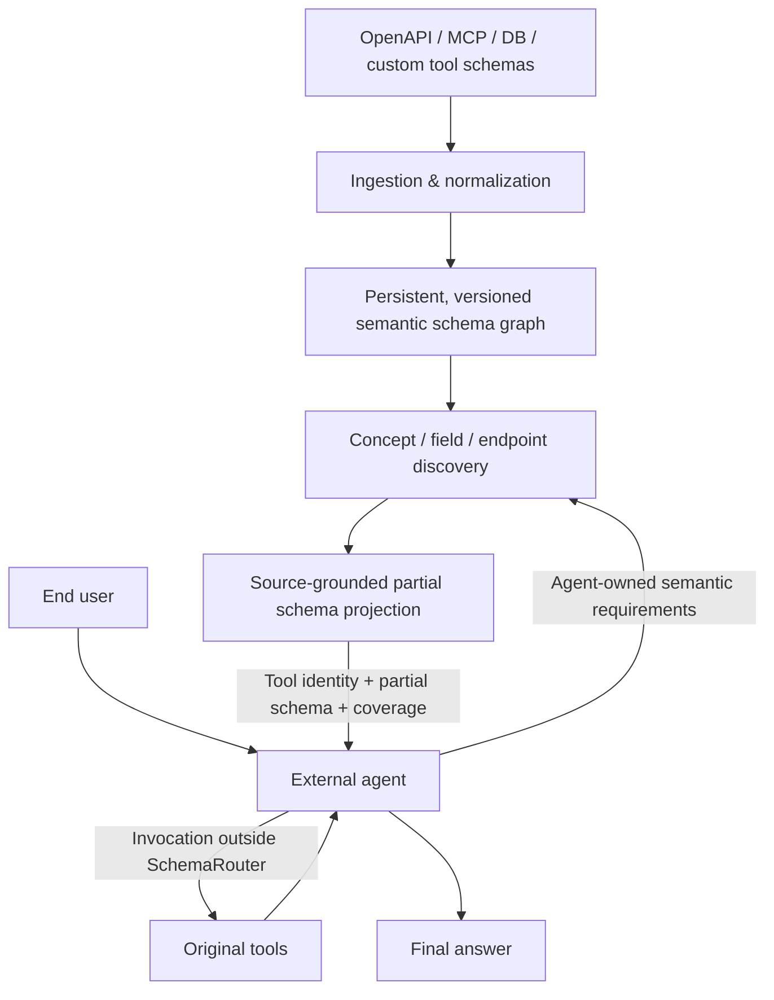

# SchemaRouter — Product Requirements Document

| Control | Value |
|---|---|
| Version | 0.1 |
| Date | 2026-11-27 |
| Status | Product reset baseline; technical choices and final statistical thresholds pending evidence |
| Parent | [#1897](https://github.com/JDeun/SchemaRouter/issues/1897) |
| Work | [#1898](https://github.com/JDeun/SchemaRouter/issues/1898) → [#1899](https://github.com/JDeun/SchemaRouter/issues/1899) → [#1900](https://github.com/JDeun/SchemaRouter/issues/1900) |
| Scope | Isolated research PoC; no new package release |

## 1. Product definition

**SchemaRouter is a field-aware semantic tool ontology and discovery index consumed by external agents.** It organizes the capabilities and schemas of heterogeneous tools as a persistent, queryable semantic graph. Agents use it to discover relevant tools and only the necessary parts of their schemas.

한국어 정의: SchemaRouter는 Agent가 필요한 도구와 필드를 탐색할 수 있도록 도구 스키마의 의미 관계를 그래프로 구축·저장하고, 관련 도구와 부분 스키마를 반환하는 인프라다. 사용자 질의의 이해와 실행은 Agent의 책임이다.

The product does not retrieve domain records, interpret the end user's question on its own, choose argument values, or execute tools. Its role is analogous to a search index over tool capabilities rather than a knowledge store over domain records. A graph or ontology alone is not evidence of novel utility.

### Problem and users

Agent developers operating heterogeneous tool catalogs must otherwise expose many irrelevant tools and large schemas, potentially spending tokens, latency and attention on irrelevant information. Tool names and descriptions alone may not reveal which endpoints can supply particular response fields or their units and provenance.

Primary user: the developer integrating an external agent with a registered, permitted tool catalog. Runtime consumer: that agent or its host. Secondary user: the catalog maintainer who imports schemas, reviews semantic annotations and maintains revisions.

### Hypothesis

Field-level semantic discovery and safe partial-schema projection can retain task-relevant tool/field coverage and downstream answer quality while reducing model-visible schema/context overhead. Test whether this is useful beyond ordinary tool retrieval and a straightforward, equivalent-metadata ontology/SPARQL solution. If the simpler approach suffices, prefer it; no commitment to building a custom engine.

## 2. Scope and boundaries

| Responsibility | External agent/host | SchemaRouter |
|---|---|---|
| Understand user intent and decompose tasks | Owns | Not required or performed internally |
| Register source schemas and trusted semantic mappings | Supplies/reviews | Imports, validates, stores |
| Request relevant capabilities | Initiates and controls budget | Searches graph and reports matches |
| Choose tools and fill argument values | Owns | Returns schema, not values |
| Select relevant schema fields | Requests needed meanings | Returns source-grounded partial views |
| Invoke tools, retrieve data, synthesize answer | Owns | Never invokes providers in discovery |
| Security/authorization | Owns identity, permitted catalog and execution | Honors trusted visibility scope; discovery does not grant execution |

Non-goals: mandatory LLM or model API, raw end-user-query interpretation pipeline, internal intent registry, autonomous planner, executor, workflow orchestration, execution-dependency path search, fixed K5, generic database or reasoner, automatic claims of semantic equivalence, graph of domain records, or provider-specific runtime dependencies in core. Do not port legacy modules merely because they exist.

The original paper's Algorithm 1 includes a separate LLM Understand stage and tool-plan output; this PRD defines the narrower new product and does not alter that historical experiment.

## 3. Target architecture



Use existing ontology/storage/query implementations where appropriate. #1898 must justify the backend and identify the minimal additional code. No physical graph database brand is mandated. The graph must be persistent, revision-aware and actually queried; a mere dependency graph or label list is not enough.

Suggested logical components (not a required module count): ingestion, normalization, ontology/store, retrieval, projection. Separate external-agent examples and evaluation from core.

## 4. Functional requirements

| ID | Priority | Requirement |
|---|---|---|
| FR-01 | P0 | Register/import source schemas with stable original tool and endpoint IDs, source revision, typed inputs and outputs, and explicit annotation provenance. Preserve the original schema as the source of truth. |
| FR-02 | P0 | Store/query semantic relationships connecting tools, endpoints, parameters, response fields, domain concepts, aliases, field groups, units, source type and license/provenance when declared. Use qualified source identifiers; do not conflate homonyms or units. |
| FR-03 | P0 | Agent-callable discovery using structured concept IDs, declared aliases and optional constraints/budgets. No internally required inference. Natural-language search beyond declared aliases is optional and separately measured, not promised by exact alias lookup. |
| FR-04 | P0 | Find matching fields and their original endpoints/tools, with traceable semantic links; support multiple independent requested concepts and multiple relevant routes. No fixed top-five cutoff, no automatic execution order. Distinguish alternatives from joint coverage; do not claim a cross-source join or full coverage merely from individual matches. |
| FR-05 | P0 | Produce valid partial schema views containing selected response fields and necessary identifiers/declared related fields. Preserve required input properties and applicable schema constraints, nested paths, references and discriminators. Preserve invocation compatibility, not just a list of names. If a safe reduction is unproved, preserve necessary original schema or report unsupported projection; never emit a malformed schema. |
| FR-06 | P0 | Return per-requirement matched/uncovered/ambiguous status, original tool/endpoint ID, source revision, field paths, declared metadata and any budget limitation. A missing concept or metadata is not invented. |
| FR-07 | P0 | Index only the host-permitted schema surface, or enforce trusted discovery scope before projection. Do not disclose disallowed schemas or fields, including via counts or diagnostic messages. Discovery has no credentials or execution authority. |
| FR-08 | P0 | Update/remove schemas and annotations with deterministic revision/invalidation behavior. Reload a persisted snapshot and prove stale fields are not returned. |
| FR-09 | P0 | Publish a small external-agent-facing example and repeatable no-model tests. Core discovery runs offline against local schemas without API keys or provider calls. |
| FR-10 | P1 | Evaluate ingestion coverage across source formats, multilingual aliases, richer semantic retrieval and catalog scale only after the minimal P0 mechanism is established. No speculative feature expansion. |

### Logical schema model

Required relationships include Tool HAS_ENDPOINT Endpoint; Endpoint ACCEPTS_PARAMETER Parameter; Endpoint RETURNS_FIELD ResponseField; ResponseField MAPS_TO_CONCEPT DomainConcept; Concept/Field ALIASED_AS; ResponseField MEMBER_OF FieldGroup; field HAS_UNIT; tool/field HAS_SOURCE_TYPE and LICENSED_AS. Preserve exact source paths and referenced input dependencies. Names are logical concepts, not required RDF predicates. Distinct physical concepts remain distinct unless reviewed source evidence supports equivalence; do not infer a license or convert units without an established contract.

Start with a tiny synthetic source manifest, one common normalized representation and declared semantic annotations. Import the exposed historical catalog next; add source-format adapters only where the PoC needs them. Source schemas lacking output definitions (including some tool declarations) cannot prove field capabilities without separately sourced annotations. Do not fabricate fields.

## 5. Agent-facing contract (proposal, to freeze in #1899)

```text
register(source_schema, reviewed_semantic_annotations) -> revision
discover(requirements, optional_scope, optional_budget) -> DiscoveryResult
update(source_id, source_schema, annotations) -> revision
remove(source_id) -> revision
```

Discovery receives an agent-created information need, not a mandatory end-user query. Contract requirements are normative; names and wire format are illustrative until ADR/API review.

Example: user asks the external agent for LiFePO4 elastic properties and major papers. The agent resolves the information need (or requests alternatives if elastic modulus is ambiguous), then asks discovery for bulk modulus and research-paper capabilities. SchemaRouter does not receive or decide the material formula, publication ranking criteria or argument values.

```json
{
  "requirements": [
    {"concept": "bulk_modulus"},
    {"concept": "research_paper"}
  ]
}
```

An illustrative result could identify a materials-property endpoint and a literature-search endpoint with respective output fields for material identifier, bulk modulus/unit and title/DOI/year, plus required input schema and source metadata. These are illustrative—not assertions about a real provider's field names or availability. An agent may request alternatives or refine constraints. If major-paper ranking requires citation counts and no declared source provides them, report that requirement as uncovered. Use a synthetic fixture to test this explicitly.

A result must distinguish an offered projected output schema from a provider-supported field-selection parameter. For sources with no server-side projection the host may filter returned data outside core; do not claim upstream payload or provider cost savings from view generation alone.

## 6. Acceptance scenarios and quality attributes

| Test | Pass condition |
|---|---|
| AC-01 Multi-need discovery | Independent property and literature needs find both relevant schema capabilities; no irrelevant fields beyond documented safety/recall dependencies. |
| AC-02 Semantic equivalence | Differently named fields mapped to the same reviewed meaning are found; bulk, shear and Young's moduli are not conflated. |
| AC-03 Ambiguity and no-fit | An ambiguous or absent requirement cannot silently become a confident unrelated hit; missing/ambiguous coverage remains explicit. |
| AC-04 Projection validity | Required inputs, schema closure, constraints, nested refs and source route identity survive; invalid reductions fail safe. |
| AC-05 Scope | Restricted routes and fields cannot appear directly or through diagnostics; no tool invocation occurs. |
| AC-06 Capacity | More than five matching routes are discoverable without a built-in cap; any caller budget reports omitted/unsatisfied coverage honestly. |
| AC-07 Lifecycle | Persist, reload, update and delete schema records; stale fields or aliases do not survive revision changes. |
| AC-08 Source provenance | Declared field units/source/license and provenance survive; unverified annotations are not elevated to verified claims. |
| AC-09 Independence | Tests execute without old planner/executor imports, LLM credentials, live providers or private paper assets. |
| AC-10 Reproducibility | Versioned fixture, dependency pin, exact commit, reproducible test commands and recorded results. |

Additional quality requirements: deterministic results for fixed graph/request/scope; clear separation of indexing, discovery and schema projection; measured cold/warm lookup, build/update latency and memory with catalog scale; transparent annotation/maintenance effort. No claim of arbitrary ontology scale before measurement. Prefer minimal dependencies and reviewed licenses. Security/integrity failures block progression regardless of performance.

## 7. Build-vs-reuse and comparative evaluation

### Gate A — #1898

Review original sources and implementation of established graph/ontology tools (RDFLib/SPARQL, OWL/RDFS/OWL-S and relevant maintained stacks), existing tool KGs and agent tool discovery. Pin revisions/licenses; distinguish observed features from gaps and hypotheses. Build an honest minimal ontology+SPARQL+projection baseline using the same metadata and fixtures. Record an ADR: adopt the simple approach, justify a small additional layer, or stop. Do not assume novelty or build a replacement generic ontology engine.

### Gate B — #1899

Implement the minimal discovery contract on the chosen backend in this isolated work area and pass AC-01–10. Use the exposed paper inventory (19 tools/166 response fields; 110 historical queries) for DEV only; record mapping gaps and annotation effort. A separate new implementation arm is unnecessary if it is exactly the generic ontology baseline.

### Gate C — #1900

Run a prospectively defined same-agent comparison:

| Arm | Treatment |
|---|---|
| A | Full available tool schemas |
| B | Ordinary lexical/vector tool-level discovery |
| C | Equivalent-metadata standard ontology/SPARQL + simple field projection |
| D | Proposed SchemaRouter layer, only if meaningfully distinct from C |
| Optional | Same selected tools, full vs partial schema; native provider retrieval when runnable and cost-approved |

Keep external agent/model, allowed source schemas and metadata, tasks, fixtures, invocation rules, scoring, retry limits and comparable cost budgets fixed. Count agent discovery turns in total operational input/output tokens and latency; separate evaluator costs. No hidden gold in the discovery index or agent input; independently authored held-out tasks, frozen protocol and sufficient sample size for decision claims. Preserve all errors, refusals and missing results; no post-score changes to final thresholds.

Metrics: tool/endpoint/required response-field recall and complete-set coverage, false accept/refusal, valid arguments at agent boundary, final task success/answer accuracy, total operational tokens, p50/p95 end-to-end latency, model-visible versus actual wire bytes, graph build/update/RSS, annotation/onboarding/maintenance effort, unauthorized exposure/execution (zero).

Candidate engineering thresholds only: task success within -2 percentage points of FULL (paired 95% CI lower bound at or above margin for a population claim), tool and field recall >=95%, target >=30% total operational token reduction vs FULL, no material latency regression, and an evidenced incremental benefit or lower maintenance cost vs C. Specify final primary endpoints, practical margins, sample size and intervals before scoring; no pass implied from these targets. If independent tasks or sufficient precision cannot be obtained, declare INCONCLUSIVE.

### Decision

GO: reproducible utility at comparable quality and a defensible added value over existing methods. NARROW: advantage only in a prospectively tested niche. REUSE: ordinary ontology plus small adapter suffices. ARCHIVE: adequately controlled results reject practical value; preserve research. INCONCLUSIVE: blocked or underpowered. No package release or replacement of main without explicit decision.

## 8. Delivery and change control

| Phase | Artifact | Exit gate |
|---|---|---|
| 0 (#1897) | PRD and isolated workspace | Scope and non-goals recorded |
| 1 (#1898) | Prior-art matrix, runnable baseline, ADR | Evidence-backed build/reuse/stop |
| 2 (#1899) | Minimal isolated PoC, tests, example | P0 acceptance scenarios verified |
| 3 (#1900) | Frozen protocol, raw outcomes, decision report | Go/No-Go review |
| 4 (conditional) | Product migration/release proposal | Separate maintainer authorization |

This PRD is the requirements reference for new product work. Issue acceptance criteria and PR changes must map to its requirement IDs; record explicit scope changes in this document and a decision comment before implementation. README is a concise orientation, not a competing requirements source. Work on the existing isolated branch; no new issues/PRs merely to restate requirements.

The old release plan and product consolidation PRs #1356 and #1895 were closed without merge. #1901 records disposition; prior paper commit/branches, published versions and negative results (#432/#506) remain intact. #199 tracks historical research. No old product code is a required dependency, no private answer keys/proprietary source in public artifacts, no paid service without approval. Existing main and release infrastructure stay unchanged through the PoC.

Open decisions: backend, precise graph vocabulary and storage layout, final API/schema envelope, supported first source format, meaning resolution beyond exact aliases, final benchmark power/margins and cost budget. Resolve in the relevant issue before making claims. No implementation or measured performance is asserted by this document.
